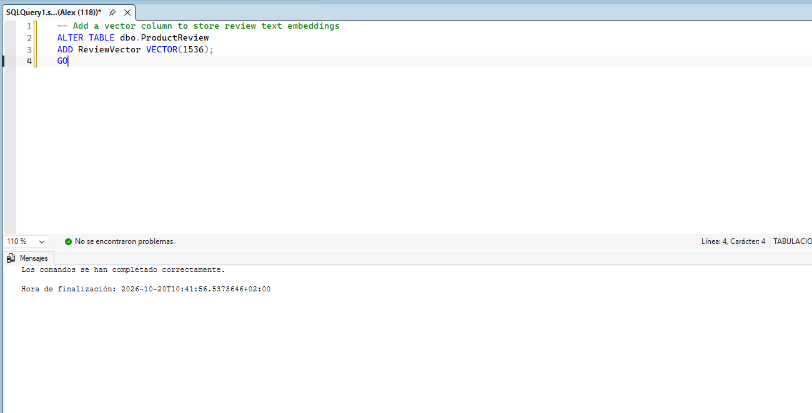
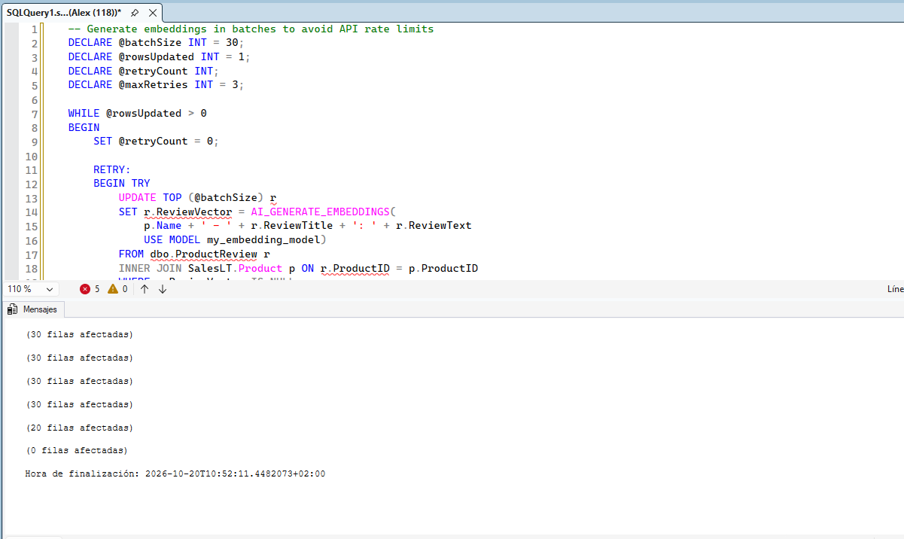
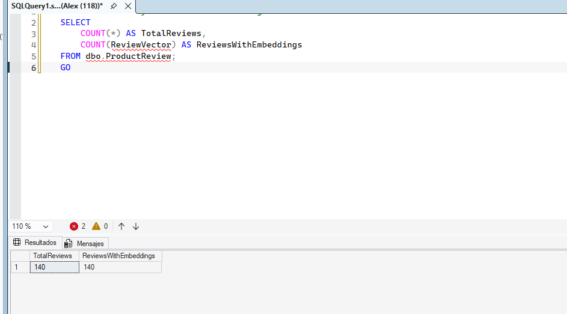
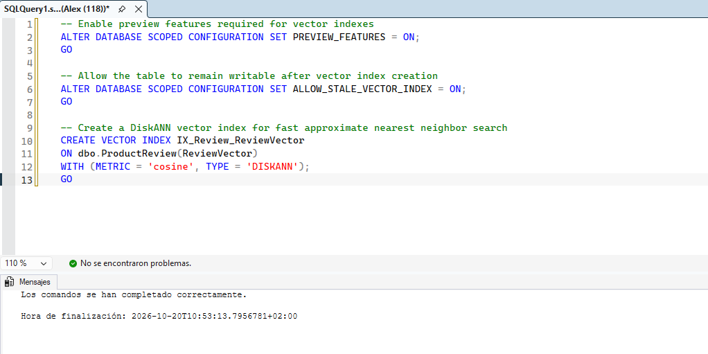
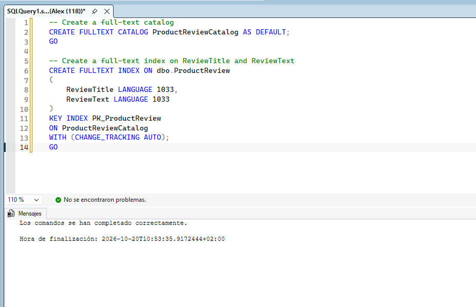

# Laboratorio 10: Implementación de búsqueda inteligente con consultas de texto completo, vectoriales e híbridas

En este laboratorio, explorarás cómo combinar la búsqueda tradicional de texto completo (Full-Text Search) con la búsqueda semántica basada en vectores. Finalmente, combinarás ambos enfoques en una "búsqueda híbrida" para obtener resultados mucho más relevantes.

## Requisitos previos

* Una base de datos Azure SQL o SQL Server.
* Visual Studio Code con la extensión **SQL Server (mssql)** o SQL Server Management Studio (SSMS).
* Comprensión básica de T-SQL, vectores y embeddings.

---

## 1. Configuración del entorno y datos de prueba

Primero, necesitamos crear una tabla para almacenar nuestros documentos, que incluirá tanto texto plano como su representación vectorial (embedding).

1. Abre tu herramienta de cliente SQL y conéctate a tu base de datos.
2. Ejecuta el siguiente script para crear la tabla y cargar datos de muestra:

```sql
-- Crear tabla de catálogo de productos
CREATE TABLE dbo.ProductCatalog (
    ProductID INT IDENTITY(1,1) PRIMARY KEY,
    ProductName NVARCHAR(100),
    Description NVARCHAR(MAX),
    DescriptionVector VECTOR(1536) -- Tamaño típico para modelos como text-embedding-ada-002
);
GO

-- Insertar datos de muestra (En un escenario real, los vectores se generan usando un modelo de IA)
INSERT INTO dbo.ProductCatalog (ProductName, Description, DescriptionVector)
VALUES 
('Laptop Pro', 'Una laptop de alto rendimiento ideal para desarrolladores y creadores de contenido.', '[0.1, 0.2, 0.3...]' /* Vector simulado */),
('Teclado Mecánico', 'Teclado mecánico con switches rojos, ideal para programar y jugar con poco ruido.', '[0.4, 0.5, 0.6...]' /* Vector simulado */),
('Monitor 4K', 'Monitor Ultra HD de 27 pulgadas con colores precisos para diseño gráfico.', '[0.7, 0.8, 0.9...]' /* Vector simulado */);
GO
```

---

## 2. Implementar Búsqueda de Texto Completo (Full-Text Search)

La búsqueda de texto completo es excelente para encontrar coincidencias exactas de palabras clave (búsqueda léxica).

1. Crea un catálogo de texto completo y un índice en la tabla `ProductCatalog`.

```sql
-- Crear el catálogo
CREATE FULLTEXT CATALOG ProductCatalogFT AS DEFAULT;
GO

-- Crear el índice de texto completo en la columna Description
CREATE FULLTEXT INDEX ON dbo.ProductCatalog(Description) 
KEY INDEX PK_ProductCatalog_ProductID 
ON ProductCatalogFT;
GO
```

2. Ejecuta una consulta basada en palabras clave utilizando `FREETEXT` o `CONTAINS`.

```sql
-- Buscar productos que mencionen "desarrolladores" o "programar"
SELECT ProductID, ProductName, Description 
FROM dbo.ProductCatalog 
WHERE CONTAINS(Description, 'desarrolladores OR programar');
```

---

## 3. Implementar Búsqueda Vectorial (Búsqueda Semántica)

La búsqueda vectorial encuentra resultados basados en el *significado* de las palabras, no solo en la coincidencia exacta. Utilizaremos la función `VECTOR_DISTANCE` (en Azure SQL) para encontrar los elementos más cercanos.

1. Supongamos que el usuario busca "equipo para escribir código". Ese texto se convierte en un vector (ej. `@queryVector`).

2. Ejecuta la búsqueda vectorial usando similitud del coseno:

```sql
DECLARE @queryVector VECTOR(1536) = '[...]' -- El vector generado a partir de "equipo para escribir código"

SELECT TOP 3 
    ProductID, 
    ProductName, 
    Description,
    VECTOR_DISTANCE('cosine', DescriptionVector, @queryVector) AS SimilarityScore
FROM dbo.ProductCatalog
ORDER BY SimilarityScore ASC; -- Para similitud del coseno (cosine), un valor menor significa mayor similitud.
```

---

## 4. Implementar Búsqueda Híbrida (Texto Completo + Vectorial)

La búsqueda híbrida combina los resultados de la búsqueda léxica (texto completo) y la búsqueda semántica (vectorial). Para fusionar los resultados de manera justa, usamos el algoritmo **Reciprocal Rank Fusion (RRF)**.

1. RRF asigna una puntuación combinada basada en el ranking de cada resultado en las dos consultas anteriores.
2. Ejecuta el siguiente script para implementar la búsqueda híbrida:

```sql
DECLARE @searchQuery NVARCHAR(100) = 'herramientas de programación';
DECLARE @queryVector VECTOR(1536) = '[...]' -- Vector de "herramientas de programación"

-- Definir constante K para el algoritmo RRF (usualmente 60)
DECLARE @K INT = 60;

WITH FullTextResults AS (
    SELECT 
        ProductID, 
        RANK() OVER (ORDER BY RANK DESC) AS FTS_Rank
    FROM CONTAINSTABLE(dbo.ProductCatalog, Description, @searchQuery)
),
VectorResults AS (
    SELECT TOP 50
        ProductID, 
        RANK() OVER (ORDER BY VECTOR_DISTANCE('cosine', DescriptionVector, @queryVector) ASC) AS Vector_Rank
    FROM dbo.ProductCatalog
)
SELECT TOP 5
    p.ProductName,
    p.Description,
    ISNULL(1.0 / (@K + f.FTS_Rank), 0) + ISNULL(1.0 / (@K + v.Vector_Rank), 0) AS RRF_Score
FROM dbo.ProductCatalog p
LEFT JOIN FullTextResults f ON p.ProductID = f.ProductID
LEFT JOIN VectorResults v ON p.ProductID = v.ProductID
ORDER BY RRF_Score DESC;
```

## Resumen

En este laboratorio, has implementado y comparado tres estrategias de búsqueda:
1. **Full-Text Search**: Ideal para coincidencias de palabras exactas.
2. **Vector Search**: Ideal para entender el contexto y el significado (semántica).
3. **Hybrid Search (con RRF)**: La mejor opción general, ya que combina la precisión léxica con la comprensión semántica.